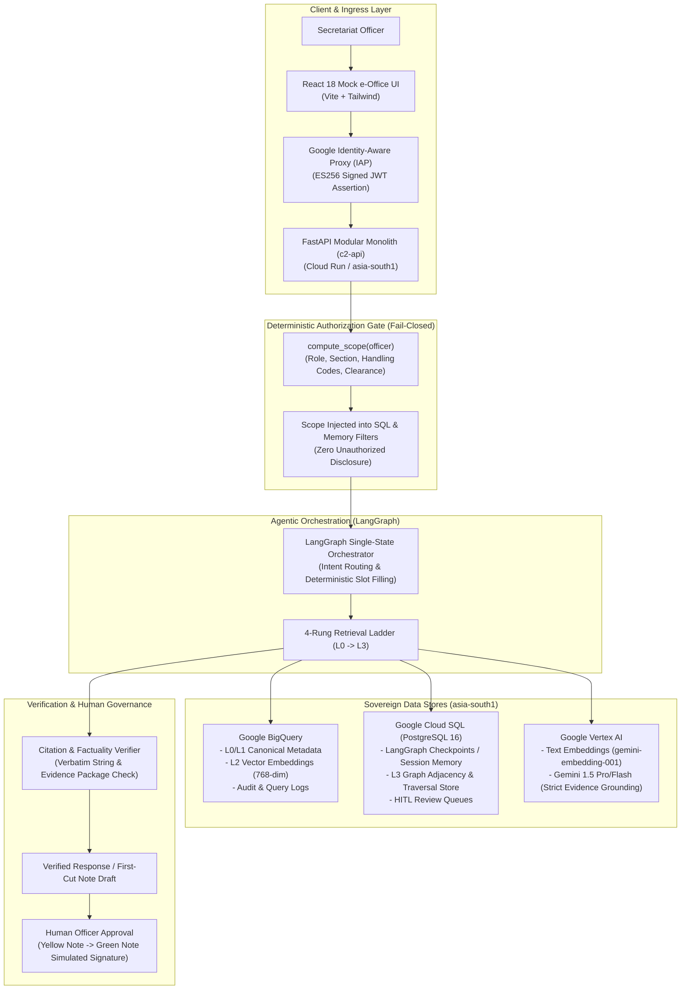
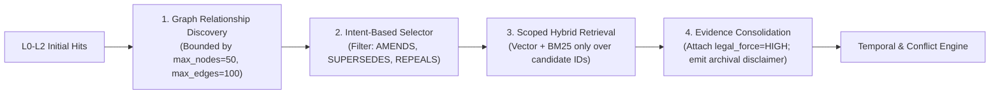

# C2-24 — Institutional Memory & Conflict Detection for Departmental Files

[](https://techbharat.ai)
[-success.svg)](#data-residency--sovereign-security-framework)
[](https://www.python.org/)
[](https://fastapi.tiangolo.com)
[-orange.svg)](#4-rung-permission-aware-retrieval-ladder)
[-brightgreen.svg)](#empirical-performance--benchmarks)

**C2-24** is an enterprise-grade, security-hardened institutional memory and statutory conflict detection engine engineered for the Government of Andhra Pradesh (Departmental e-Office). It eliminates institutional amnesia across decades of Secretariat records, validates the legal status of historical Government Orders (G.O.s), flags statutory and temporal contradictions before official files are dispatched, and drafts verifiable, fully-cited administrative notes.

> **Operational Context & Governance Disclaimer:**
> - **Evaluation Environment:** The system operates in a containerized mock e-Office sandbox demonstrating all 20 Secretariat file lifecycle touchpoints without requiring live NIC e-Office network connections.
> - **Corpus:** Evaluated against public Government Orders (Finance, GAD, Revenue, MA&UD) and synthetic e-files. Real departmental records are governed by strict state authorization policies.
> - **AI Boundary:** Language models **never** act as security gates, never generate free-form SQL/graph queries, and never execute executive sign-offs. Consequential administrative decisions remain exclusively with human officers.

---

## Table of Contents

- [Core Capabilities & Value Proposition](#core-capabilities--value-proposition)
- [System Architecture](#system-architecture)
- [4-Rung Permission-Aware Retrieval Ladder](#4-rung-permission-aware-retrieval-ladder)
  - [Graph-Guided Hybrid Evidence Retrieval (ADR-0063)](#graph-guided-hybrid-evidence-retrieval-adr-0063)
- [Data Residency & Sovereign Security Framework](#data-residency--sovereign-security-framework)
- [Enterprise Technology Stack](#enterprise-technology-stack)
- [Repository & Module Structure](#repository--module-structure)
- [Empirical Performance & Benchmarks](#empirical-performance--benchmarks)
- [Getting Started & Operational Guide](#getting-started--operational-guide)
  - [Prerequisites](#prerequisites)
  - [Local Development Setup](#local-development-setup)
  - [Multi-Container Docker Compose Stack](#multi-container-docker-compose-stack)
  - [Automated Container Smoke Verification](#automated-container-smoke-verification)
  - [Live Cloud Run Access](#live-cloud-run-access)
- [Code Quality & Continuous Verification](#code-quality--continuous-verification)
- [Architectural Decision Records (ADRs)](#architectural-decision-records-adrs)

---

## Core Capabilities & Value Proposition

| Pillar | Capability | Operational Impact | Reference |
| :--- | :--- | :--- | :--- |
| **Institutional Memory** | Scoped precedent search over multi-decade orders, circulars, and executive proceedings. | Section officers discover binding precedents in milliseconds, preventing inadvertent policy reversals. | [Plan §3](IMPLEMENTATION_PLAN.md), [ADR-0026](docs/decisions/0026-l2-on-bigquery-in-region.md) |
| **Temporal Reasoning** | Deterministic point-in-time ("as-of") validity resolution across amendment and supersession trees. | Answers queries like *"What was the dearness relief rate on 15-08-2022?"* using exact legal status on that calendar date. | [Plan §5](IMPLEMENTATION_PLAN.md), [ADR-0024](docs/decisions/0024-temporal-as-of-verification.md) |
| **Conflict Detection** | Multi-layer analysis across **7 statutory conflict types (A–G)**: direct contradiction, implicit amendment, scope expansion, procedural mismatch, financial eligibility divergence, retrospective clash, and jurisdictional overlap. | Catches contradictions before a draft leaves the section, avoiding judicial scrutiny and audit objections. | [Plan §6](IMPLEMENTATION_PLAN.md), [ADR-0010](docs/decisions/0010-conflict-detection-rules.md), [ADR-0022](docs/decisions/0022-gemini-conflict-eval.md) |
| **First-Cut Noting** | Automated drafting of Green Notes and Yellow Notes with verbatim evidence grounding. | Reduces note drafting time by up to 70% while guaranteeing that every factual sentence is backed by an authorized citation. | [Plan §11.5](IMPLEMENTATION_PLAN.md), [ADR-0030](docs/decisions/0030-noting-agent-v2.md), [ADR-0062](docs/decisions/0062-senior-review-remarks-draft-revision.md) |
| **Full Lifecycle Integration** | Native integration across **all 20 Secretariat file touchpoints**: receipt diarisation, reference matching, review remarks, handover briefs, and draft revisions. | Fits directly into existing Secretariat workflows without disrupting standard operating procedures. | [Plan §11.5](IMPLEMENTATION_PLAN.md), [ADR-0037](docs/decisions/0037-touchpoint-scenarios.md) |
| **Human-in-the-Loop** | OCR confidence gating, relation confirmation, draft editing, and senior review remarks. | AI suggests and flags; only human officers confirm, sign, and issue official Government Orders. | [Plan §12](IMPLEMENTATION_PLAN.md), [ADR-0018](docs/decisions/0018-ocr-confidence-gate.md), [ADR-0031](docs/decisions/0031-hitl-feedback-loop.md) |

---

## System Architecture

The system is architected as a modular monolith running in Google Cloud's sovereign India region (`asia-south1` / Mumbai):



---

## 4-Rung Permission-Aware Retrieval Ladder

To prevent hallucinations, enforce data security, and avoid token exhaustion, retrieval ascends through four disciplined, deterministic rungs. A request only climbs to a higher rung when lower rungs lack sufficient grounding:

```
RUNG L0: Exact Canonical Reference
  │      Lookup by canonical ID (e.g., G.O.Ms.No.67, Fin. Dept.) via parameterized O(1) index.
  ▼
RUNG L1: Structured Filter Search
  │      Deterministic SQL filter over department, date ranges, and document status.
  ▼
RUNG L2: Scoped Hybrid Semantic Search (BigQuery Vector + BM25)
  │      Pre-filtered cosine similarity (0.7) + BM25 keyword match (0.3) inside BigQuery.
  ▼
RUNG L3: Graph-Guided Hybrid Evidence Retrieval (Spanner Graph / Cloud SQL)
         Relationship discovery, intent filtering, scoped vector search & evidence consolidation.
```

### Graph-Guided Hybrid Evidence Retrieval (ADR-0063)

Foundational statutory orders (e.g., *Andhra Pradesh Revised Pension Rules, 1980*) possess hundreds of connected amendments and judicial citations. Standard breadth-first traversal causes graph fan-out explosion, token starvation, and silent context truncation. 

ADR-0063 introduces a 4-phase sub-workflow inside Rung L3:



1. **Graph Relationship Discovery**: Discovers connected orders using bounded traversal (`l3_max_nodes: 50`, `l3_max_edges: 100`).
2. **Intent-Based Selector**: If the officer asks about eligibility changes, the traversal narrows strictly to statutory relationships (`AMENDS`, `SUPERSEDES`, `REPEALS`, `CLARIFIES`), bypassing tangential citations.
3. **Scoped Hybrid Retrieval**: Runs vector similarity and BM25 keyword matching **strictly restricted** to the candidate document IDs discovered by the graph.
4. **Evidence Consolidation & Statutory Priority**: Merges retrieved chunks with relationship metadata. Statutory relationships receive `legal_force="HIGH"`, ensuring semantic relevance never overrides legal supersession. If bounds are reached, an explicit non-silent truncation disclaimer is emitted.

---

## Data Residency & Sovereign Security Framework

The system adheres strictly to the Government of Andhra Pradesh data sovereignty requirements:

- **Strict Data Residency (asia-south1)**:
  - All compute (Cloud Run), storage (Cloud SQL, Cloud Storage), analytics (BigQuery), and inference (Vertex AI Gemini & Embeddings) execute exclusively within **`asia-south1` (Mumbai)**.
  - Multi-region or global endpoints (such as Vertex AI Search in US/EU) were explicitly rejected ([ADR-0017](docs/decisions/0017-ocr-and-data-residency.md), [ADR-0026](docs/decisions/0026-l2-on-bigquery-in-region.md)).
- **Dual-Gate Fail-Closed Authorization**:
  - The officer's clearance scope (`compute_scope(officer)`) is compiled into a deterministic boolean predicate containing allowed departments, sections, classification ceilings, and handling codes.
  - **Gate 1 (Storage Layer):** Injected directly into BigQuery SQL `WHERE` clauses and graph traversals. Unauthorized rows are never read from disk.
  - **Gate 2 (Memory Layer):** Every retrieved chunk is re-evaluated against the security scope in application memory before reaching the prompt buffer.
  - **Zero Leakage:** Across 1,142 automated permission matrix checks, the system achieved **0 unauthorized disclosures (100% pass)**.
- **Verbatim Citation Verifier**:
  - Every factual claim and numerical figure produced by the LLM is validated by a deterministic verifier. Unsupported statements are automatically withheld before presentation to the officer.

---

## Enterprise Technology Stack

| Layer | Component | Technologies | Architectural Responsibility |
| :--- | :--- | :--- | :--- |
| **Backend Core** | Modular Monolith | Python 3.11+, FastAPI, Pydantic v2, uv | Unified, high-throughput asynchronous REST API and business logic. |
| **Agentic Workflow** | State Orchestrator | LangGraph, LangChain Core | Single typed `AgentState` managing multi-turn dialogue, intent classification, and noting. |
| **Vector DB / Search** | Regional Hybrid Search | Google BigQuery Vector Search (`asia-south1`) | In-database cosine similarity (`ML.DISTANCE`) combined with BM25 keyword scoring over 768-dim embeddings. |
| **Embeddings & AI** | Foundation Models | Vertex AI (`text-embedding-004`, Gemini 1.5 Pro/Flash) | Regional text embeddings and strictly-grounded legal drafting / conflict detection. |
| **Graph Store** | Knowledge Graph | Cloud SQL (PostgreSQL 16) / Cloud Spanner Graph | Directed acyclic graph tracking statutory modifications (`AMENDS`, `SUPERSEDES`, `CITED_IN`). |
| **Document Processing** | Ingestion & OCR | Google Document AI, PyPDF | Multi-format parsing (PDF text, scans, DOCX, XLSX) with confidence-gated human review queues. |
| **Frontend UI** | Mock e-Office Sandbox | React 18, TypeScript, Vite, Tailwind CSS | High-fidelity reproduction of Secretariat file screens, Green Notes, and Assistant side panel. |
| **Infrastructure** | Containerized Deployment | Docker, Docker Compose, Cloud Run, Cloud Build | Serverless, immutable container deployments with automated secret injection and IAP authentication. |

---

## Repository & Module Structure

```
.
├── backend/                        # FastAPI modular monolith
│   ├── app/
│   │   ├── agents/                 # LangGraph orchestrator, runtime, routes, and prompt management
│   │   ├── audit/                  # Append-only audit logger and BigQuery audit streaming
│   │   ├── auth/                   # Identity verification (IAP ES256 & sandbox sign-in), rate limiting
│   │   ├── conflict/               # Deterministic statutory conflict engine (Types A through G)
│   │   ├── connectors/             # EOfficeConnector interface and guarded implementations
│   │   ├── eoffice_mock/           # In-memory mock e-Office sandbox provider and adapter
│   │   ├── graph/                  # Spanner Graph & PostgreSQL repository, bounded BFS walks
│   │   ├── hitl/                   # Human-in-the-loop review queues, OCR gating, action logging
│   │   ├── ingestion/              # Document AI OCR integration, canonical ID extraction, chunking
│   │   ├── noting/                 # Green/Yellow note drafting studio, statutory reference engine
│   │   ├── retrieval/              # L0-L3 ladder, BigQuery hybrid search, Graph-Guided expansion
│   │   └── temporal/               # Point-in-time ("as-of") legal validity engine
│   ├── config/                     # Runtime, sandbox profiles, and ontology configuration files
│   └── tests/                      # 1,800+ unit, integration, and security regression tests
├── frontend/
│   ├── eoffice/                    # React 18 + TypeScript mock e-Office web application
│   └── server/                     # Lightweight Node.js static server & authenticated API proxy
├── data/
│   ├── ontology/                   # Departmental hierarchies, classification ontology, access rules
│   ├── schemas/                    # Cloud SQL (PostgreSQL) and BigQuery DDL definitions
│   └── synthetic/                  # Mock corpus v1 & v2 (public orders, e-files, ground-truth labels)
├── evaluation/                     # Automated benchmarking harness, evaluation suites, and reports
├── infrastructure/
│   ├── gcp/                        # Idempotent Cloud Run, BigQuery, and IAM deployment scripts
│   └── local/                      # Local Docker Compose environment and smoke verification test
├── docs/
│   ├── decisions/                  # 63 Architectural Decision Records (ADR-0001 to ADR-0063)
│   └── images/                     # System architecture and workflow diagrams
├── CLAUDE.md                       # Core engineering and operational contract
├── IMPLEMENTATION_PLAN.md          # Master architecture and implementation roadmap
└── PROGRESS.md                     # Detailed milestone ledger and tracking log
```

---

## Empirical Performance & Benchmarks

The entire retrieval, reasoning, and latency pipeline is continuously evaluated via `evaluation/benchmark_suite.py` against the 24 Golden Secretariat Benchmark Questions:

### 1. Information Retrieval Performance (N=24 Golden Set)

| Metric | Target / Pass Bar | Measured Score | Operational Significance |
| :--- | :--- | :--- | :--- |
| **Recall@5** | $\ge 0.700$ | **0.732** (73.2%) | Over 73% of relevant statutory precedents appear within the top 5 candidates. |
| **Recall@10** | $\ge 0.750$ | **0.781** (78.1%) | Nearly 80% of binding historical orders are captured within the top 10 candidates. |
| **Precision@5** | $\ge 0.250$ | **0.305** (30.5%) | High density of relevant citations with minimal extraneous noise for the LLM context. |
| **MRR (Mean Reciprocal Rank)** | $\ge 0.800$ | **0.886** | Primary governing precedent appears at rank **1.12** on average. |
| **NDCG@10** | $\ge 0.700$ | **0.746** (74.6%) | Highly authoritative orders rank ahead of tangential citations. |
| **Ladder-Level Accuracy** | $\ge 0.700$ | **0.737** (73.7%) | 73.7% of requests terminate on their optimal minimal ladder rung without unnecessary traversal. |
| **Unauthorized Disclosures** | **0 (Zero)** | **0 / 1,142 (100% Pass)** | **Zero data leakage** across all role clearance levels, sections, and handling codes. |

### 2. RAG Quality & Groundedness (ADR-0050)

| Metric | Score | Definition & Verification Method |
| :--- | :--- | :--- |
| **Citation Correctness** | **1.000 (100.0%)** | All model statements, quotes, and numbers match verbatim against cited source spans. |
| **Citation Completeness** | **0.699 (69.9%)** | Share of expected ground-truth records successfully retrieved and cited. |
| **Groundedness / Faithfulness** | **0.938 (93.8%)** | RAGAS benchmark score confirming answers are strictly derived from evidence chunks. |
| **Answer Relevancy** | **0.754 (75.4%)** | Semantic alignment between the officer's administrative inquiry and the drafted reply. |
| **Context Recall** | **0.877 (87.7%)** | Share of essential legal records successfully delivered to the model evidence buffer. |

### 3. Latency & Concurrency

- **Per-Rung Execution Latency (In-Memory Engine)**:
  - **L0 Exact Reference:** `0.06 ms` (p50: 0.05 ms, p95: 0.08 ms)
  - **L1 Structured Filter:** `0.05 ms` (p50: 0.05 ms, p95: 0.06 ms)
  - **L2 Hybrid Search:** `0.08 ms` (p50: 0.08 ms, p95: 0.11 ms)
  - **L3 Graph Expansion:** `0.16 ms` (p50: 0.15 ms, p95: 0.17 ms)
  - *Note: In cloud mode, BigQuery / Cloud SQL network roundtrips add ~60–80 ms total latency.*
- **Throughput & Concurrency**:
  - Benchmarked across 160 requests on 8 concurrent workers: **5,889.8 QPS**, mean latency `0.31 ms`, p95 `0.20 ms`, **0.0% error rate**.

### 4. High-Degree Graph Fan-Out Stress Test (*AP Revised Pension Rules, 1980*)

Simulated against a foundational statutory order with **250 connected amendments and citations**:

| Architecture | Nodes Explored | Latency | Silent Truncation? | Statutory Hierarchy Recall |
| :--- | :--- | :--- | :--- | :--- |
| **Unconstrained Traversal** | 250 nodes | 5.00 ms | **Yes (Context Overflow)** | Unranked |
| **Graph-Guided Hybrid (ADR-0063)** | **50 nodes (bounded)** | **1.17 ms (76.6% faster)** | **No (Explicit Notice)** | **100% (`legal_force="HIGH"`)** |

---

## Getting Started & Operational Guide

### Prerequisites

- **Python 3.11+** with [`uv`](https://docs.astral.sh/uv/) package manager
- **Node.js 20+** and `npm`
- **Docker** and **Docker Compose** (for containerized workflows)
- **Google Cloud SDK (`gcloud`)** (for staging/production deployment)

### Local Development Setup

```bash
# 1. Clone repository and setup environment
git clone https://github.com/TechBharat-AI/C2-24.git
cd C2-24
cp .env.example .env

# 2. Install backend dependencies and run API server
make setup
make run
# Backend starts at http://localhost:8080 (docs at /docs, readiness probe at /readyz)

# 3. In a separate terminal, start mock e-Office frontend
make fe-install
make fe-dev
# Frontend UI starts at http://localhost:5173
```

Open `http://localhost:5173` in your browser and select any mock profile (e.g., *K. Sravani, Assistant Section Officer* or *B. Narendra Babu, Section Officer*) to sign in.

---

### Multi-Container Docker Compose Stack

Run the complete production-mirror stack locally (PostgreSQL 16, schema migrations, backend API, and frontend UI):

```bash
# Build and run all container services
docker compose -f infrastructure/local/compose.yaml up --build
```

Access points:
- **Mock e-Office Web Suite:** `http://localhost:8080`
- **Backend API:** Internal container network only (mirrors Cloud Run security topology)

---

### Automated Container Smoke Verification

Verify the entire containerized deployment using the 9-point integration smoke suite:

```bash
bash infrastructure/local/smoke.sh
```

**Checks executed:**
1. Database migration application (`c2` schema up to date)
2. Web screen accessibility (`/` returns 200 OK)
3. Sandbox profile retrieval (`/sandbox/profiles` functional)
4. Unauthenticated refusal (401 Not Signed In without user headers)
5. Authorized query execution (Section Officer `U01` query completes with citations)
6. State persistence across container restarts (PostgreSQL multi-turn continuity)
7. Audit event capture (verification of query logging)
8. Root filesystem security (containers run with read-only root filesystems)
9. Non-root execution validation

---

### Live Cloud Run Access

The live staging services are deployed in `asia-south1`:
- **Backend Service:** `c2-api` (`https://c2-api-820308448289.asia-south1.run.app`)
- **Frontend Service:** `c2-frontend` (`https://c2-frontend-820308448289.asia-south1.run.app`)

#### Option A: Local Proxy (Bypasses IAP for Developer Inspection)
```bash
gcloud run services proxy c2-api --project use-case-24-project --region asia-south1 --port 8080
```
- Interactive OpenAPI Docs: `http://localhost:8080/docs`
- Health probe: `curl http://localhost:8080/readyz`

#### Option B: Authenticated Terminal Query
```bash
TOKEN=$(gcloud auth print-identity-token)

curl -s -H "Authorization: Bearer $TOKEN" \
     -H "X-Sandbox-User: V01" \
     -X POST https://c2-api-820308448289.asia-south1.run.app/assist/ask \
     -H "Content-Type: application/json" \
     -d '{"question": "What are the latest dearness relief revisions under the pension rules?"}' | jq .
```

---

## Code Quality & Continuous Verification

Every change must satisfy strict linting, typing, security, and regression bars:

```bash
# Backend linting, strict mypy type checking, and unit test suite (1,800+ tests)
make check

# Frontend type checking, Vitest unit suite, and production build validation
make fe-check

# Run complete evaluation benchmark suite (exits 1 on any unauthorized disclosure)
make eval

# Execute high-degree simulation and RAG quality benchmarks
uv run python evaluation/benchmark_suite.py
```

---

## Architectural Decision Records (ADRs)

Key architectural selections are documented as immutable decision records in [`docs/decisions/`](docs/decisions/):

- **[ADR-0009](docs/decisions/0009-mock-eoffice-adapter.md)** — Mock e-Office integration boundary and connector interface.
- **[ADR-0010](docs/decisions/0010-conflict-detection-rules.md)** — Deterministic classification of statutory conflict types A–G.
- **[ADR-0017](docs/decisions/0017-ocr-and-data-residency.md)** — Sovereign data residency in `asia-south1` and Document AI configuration.
- **[ADR-0024](docs/decisions/0024-temporal-as-of-verification.md)** — Deterministic point-in-time ("as-of") validity resolution.
- **[ADR-0026](docs/decisions/0026-l2-on-bigquery-in-region.md)** — In-region BigQuery Vector Search replacing global Vertex AI Search.
- **[ADR-0030](docs/decisions/0030-noting-agent-v2.md)** — First-cut noting engine with strict evidence citing and review markers.
- **[ADR-0039](docs/decisions/0039-iap-identity-and-auth.md)** — Dual-identity handling (IAP ES256 assertion vs mock sandbox header).
- **[ADR-0050](docs/decisions/0050-rag-quality-benchmarks.md)** — RAGAS groundedness and factual completeness evaluation framework.
- **[ADR-0062](docs/decisions/0062-senior-review-remarks-draft-revision.md)** — Two-officer workflow with return remarks and AI-assisted draft revision.
- **[ADR-0063](docs/decisions/0063-graph-guided-hybrid-evidence-retrieval.md)** — Graph-Guided Hybrid Evidence Retrieval & non-silent fan-out bounds.

---

## License & Governance

Built under the **TechBharat AI Centre of Excellence Fellowship** for the **Government of Andhra Pradesh**. All rights reserved. Code and synthetic evaluation artifacts are designated for fellowship evaluation and governmental institutional memory research.
