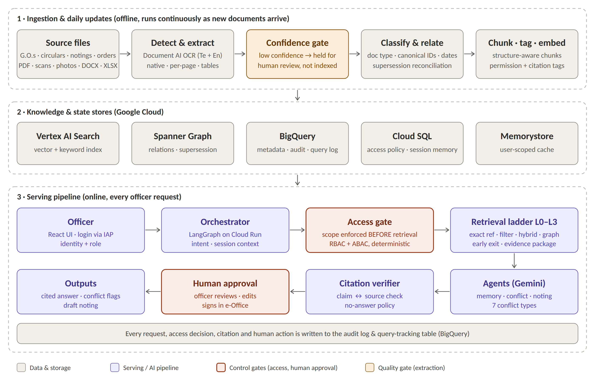

# C2-24 — Institutional Memory & Conflict Detection for Departmental Files

TechBharat AI CoE Fellowship, Cohort #2 (Government of Andhra Pradesh).

C2-24 helps officers working on e-Office files with three things:
- find earlier decisions, orders and precedents;
- check which orders are still in force on a given date;
- catch conflicts before a file moves on.

Every answer cites the records it rests on. The assistant only ever sees records the officer is allowed to open.

> **Status: proof of concept on synthetic data.**
> - The demo runs inside a **mock e-Office sandbox**. It is not NIC e-Office and has no live e-Office integration.
> - The corpus, officers, hierarchy and access policy are synthetic or mock values pending department confirmation.
> - No real departmental data is in this repository.

## What it does

| Area | Summary | Design |
|---|---|---|
| Permission-aware retrieval | Four rungs, all run inside the officer's computed scope: L0 exact reference → L1 structured filter → L2 hybrid search → L3 graph expansion. Every candidate is re-checked before it reaches the model | Plan §3, ADR-0026 |
| Temporal reasoning | Supersession chains, effective dates and as-of-date questions, all decided by deterministic rules | Plan §5 |
| Conflict detection | Seven types, A–G: deterministic where the facts exist, Gemini only for grounded judgement | Plan §6, ADR-0010, ADR-0022 |
| Cited answers and first-cut noting | Every factual line must cite evidence from the authorised package. Citations are verified, and unsupported claims are withheld | ADR-0024, ADR-0030 |
| Human review | OCR review queue, confirmation of inferred relations, Yellow-Note drafts only. The officer always acts | ADR-0018, ADR-0031 |
| e-Office touchpoints | All 20 plan touchpoints: diarising a receipt, the pre-send check, closing remarks, section handover and the rest | Plan §11.5, ADR-0037, ADR-0038 |
| Monitoring | Query log, answer times, feedback, plus cross-department alerts for unusual activity | ADR-0035, ADR-0036 |
| Production hardening | IAP-verified identity, request limits, body cap, timeouts, pooled Postgres, read/write concurrency, readiness probe | ADR-0039 |

## Architecture



- **Application:** a modular monolith. One FastAPI backend with LangGraph orchestration, plus React screens; both run on Cloud Run in `asia-south1`.
- **Data and AI services:**
  - BigQuery (L0–L2, query log);
  - Cloud SQL for PostgreSQL (application state, graph, audit);
  - Document AI (OCR);
  - Vertex AI for Gemini and embeddings.
- **Integration boundary:** the sandbox reaches the core only through the `EOfficeConnector` interface (`backend/app/connectors/`).

The full design is in [`IMPLEMENTATION_PLAN.md`](IMPLEMENTATION_PLAN.md); plan sections (§) in this README and in code comments refer to it. Decision records (ADR-NNNN) are kept by the team outside this repository.

## Repository layout

```
backend/              FastAPI service (Python 3.11+, uv)
  app/                modules: auth, ingestion, identifiers, retrieval, graph, temporal, conflict,
                      precedent, noting, citation, hitl, memory, cache, tracking, audit, agents,
                      connectors, eoffice_mock
  config/             runtime, sandbox and monitoring settings (YAML)
  prompts/            versioned prompts (never inline)
  tests/unit/         pytest suite — no cloud credentials needed
frontend/
  eoffice/            mock e-Office sandbox screens (React + TypeScript, Vite, Vitest)
  server/             static server + API proxy used on Cloud Run
data/
  ontology/           departments, roles, hierarchy, classification, access and authority rules (mock)
  schemas/            BigQuery and PostgreSQL schemas
  synthetic/          synthetic corpus, e-files and ground truth (evaluation only)
data_collection/      tools that assembled the public G.O. corpus (ADR-0006)
evaluation/           harness, suites and dated reports; the only reader of the ground truth
infrastructure/
  gcp/                numbered, idempotent gcloud setup scripts
  local/              compose.yaml (whole stack in containers) + smoke.sh; docker-compose.yml (data stores for `make local-up`)
docs/images/          architecture diagrams
```

## Getting started

Prerequisites: Python 3.11+ with [uv](https://docs.astral.sh/uv/), Node 20+, and optionally Docker.

```bash
cp .env.example .env      # placeholder names only; defaults run fully in memory
make setup                # backend dependencies
make run                  # API on http://localhost:8080
make fe-install && make fe-dev   # sandbox screens on http://localhost:5173
```

Sign in on the sandbox screen by picking a mock officer. In the default `sandbox` mode no cloud services or credentials are used.

### Or run everything in containers (Docker)

```bash
docker compose -f infrastructure/local/compose.yaml up --build   # → http://localhost:8080
bash infrastructure/local/smoke.sh                                # build, start, 9 checks, stop
```

Postgres, the schema job, the API and the screens, as on Cloud Run: the API has no host port and is reached only through the screens server. Base images can come from a registry mirror (`PYTHON_IMAGE`, `NODE_IMAGE`, `UV_IMAGE`, `POSTGRES_IMAGE`); see ADR-0043.

## Checks

| Command | What it runs |
|---|---|
| `make check` | ruff lint and format check, mypy (strict), pytest |
| `make fe-check` | TypeScript type check, Vitest, production build |
| `make eval` | Evaluation harness, written to `evaluation/reports/`. Exits 1 on any unauthorised disclosure |

To run the Postgres-backed tests against a real database, point `C2_TEST_PG_DSN` at a throwaway Postgres 16, e.g. `C2_TEST_PG_DSN="host=localhost port=5432 user=c2 dbname=c2test" make test`.

### Latest results

Synthetic corpus, reference stack (run of 17 Nov 2026; reports are written to `evaluation/reports/`, kept locally):
- **Leakage:** 0 disclosures in 1,142 checks.
- **Retrieval:** recall@10 0.754, MRR 0.833.
- **Conflicts:** types A/C/E/F precision 1.000, recall 1.000.
- **Touchpoint scenarios:** 24/24.

These thresholds are uncalibrated test values. The figures are a baseline for comparison, not a performance claim.

## Security

The language model is never the security boundary. Access is computed deterministically before retrieval and re-checked on every candidate; any failure denies with a neutral message. See [`SECURITY.md`](SECURITY.md).
