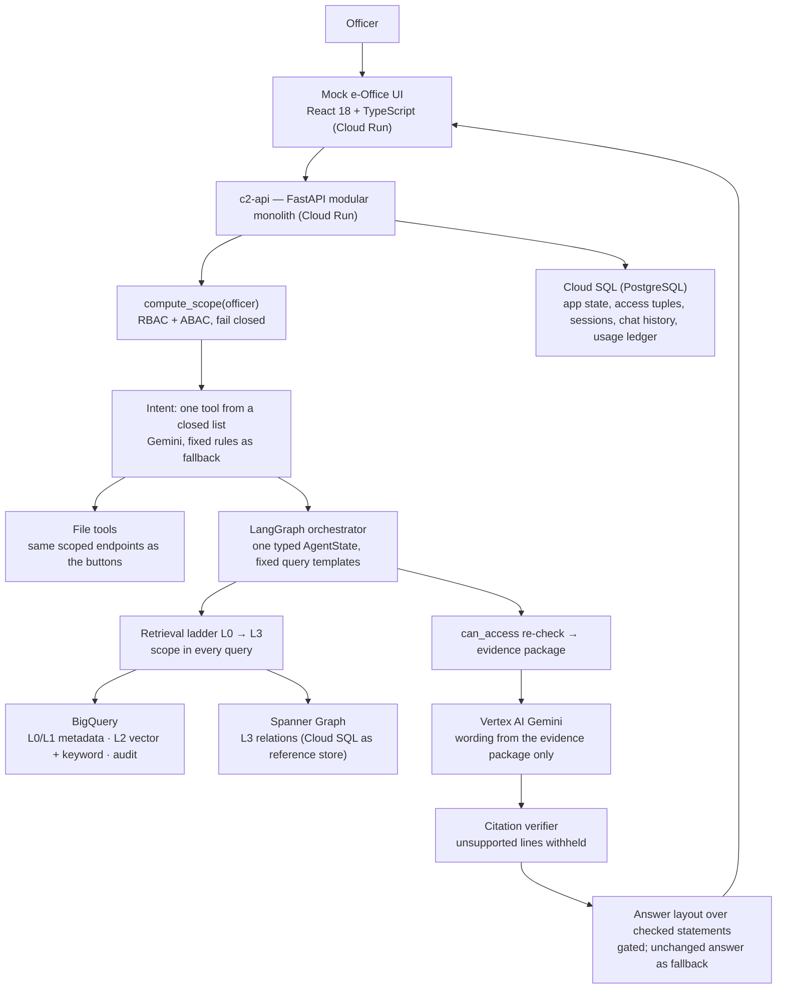

# C2-24 — Institutional Memory & Conflict Detection for Departmental Files


A permission-aware AI assistant for government e-Office files. While an officer works on a file,
it finds the orders and earlier decisions that apply, says whether each is still in force, flags
possible conflicts before the file is sent, answers questions about the file in plain language,
and prepares cited notes and drafts for approval that the officer edits and saves.

Built for problem statement **C2-24** of the TechBharat AI CoE Fellowship (Cohort #2, Government
of Andhra Pradesh).

> **Status and scope**
> - **Proof of concept.** It runs inside a **mock e-Office sandbox** ("Mock e-Office sandbox — not
>   NIC e-Office · synthetic data"). There is no connection to NIC e-Office.
> - **Data.** Public Government Orders and synthetic e-files only; no real departmental records.
>   The hierarchy, roles and access policy are mock values `[To confirm]` with the department.
> - **AI boundary.** The model is never the security boundary, never writes SQL, graph or search
>   queries, and never signs, approves, sends or closes anything. Officers make every decision;
>   signatures in the sandbox are simulated clicks (no DSC, eSign, Parichay or Aadhaar).

---

## Contents

- [What it does](#what-it-does)
- [How an officer uses it](#how-an-officer-uses-it)
- [Architecture](#architecture)
- [Retrieval ladder](#retrieval-ladder)
- [The assistant and the model](#the-assistant-and-the-model)
- [Security model](#security-model)
- [Technology stack](#technology-stack)
- [Repository layout](#repository-layout)
- [Getting started](#getting-started)
- [Testing and evaluation](#testing-and-evaluation)
- [Results](#results)
- [Deployment](#deployment)
- [Documentation](#documentation)
- [Known limitations](#known-limitations)
- [Contributing](#contributing)
- [License](#license)

---

## What it does

| Area | What it does |
|---|---|
| Institutional memory | Scoped search over orders, circulars and earlier file decisions; every answer line is cited to a record the officer may open. |
| Temporal reasoning | Deterministic in-force / superseded status and as-of-date answers from the supersession and amendment chain, never a model guess. |
| Conflict detection | Seven advisory types: **A** superseded reference · **B** direct contradiction · **C** wrong authority or procedure · **D** precedent inconsistency (review only) · **E** missing authority · **F** temporal mismatch · **G** hierarchy conflict. Deterministic where facts exist; the model only for grounded judgment. |
| File assistant | One chat per file: summary, next action, movements, records, approval brief, changes since the decision, pre-send check, related files, first-cut note, draft for approval, closing remarks, references to earlier notes and order status — by button or in plain words. |
| Noting and drafting | First-cut Yellow Notes and drafts for approval in the chosen e-Office format (note, G.O.Ms., G.O.Rt., memo, circular, letter); facts from the file with citations; anything unverified is flagged. Saved only on the officer's click. |
| e-Office touchpoints | All 20 touchpoints of plan §11.5 in the sandbox: receipt diarisation, pre-send check, reference matching, handover brief, return with remarks, draft revision and more. |
| Human review | OCR confidence gate and review screen, relation confirmation, feedback captured as evaluation data. |
| Chat history | Each officer's conversations are kept by the server, continue where they stopped, and can be deleted one by one or all at once in Settings. |

---

## How an officer uses it

1. **Sign in** (sandbox): choose a mock officer. Post, section, clearance and search scope decide
   what they can see.
2. **Open a file.** The page shows the notes, correspondence and movements. A floating **AI
   button** (bottom right) opens the file's chat.
3. **Ask in plain words** — "summarise this file", "what is my next action", "has this been
   decided before?", "prepare a draft note for approval". The assistant works out which tool is
   meant, answers with sources, and offers drafts the officer can edit and save.
4. **Send** runs the pre-send check in the chat; nothing is ever sent by the assistant.
5. **Ask AI** in the top bar is the general chat over every file and record the officer may open.

---

## Architecture

A modular monolith (one FastAPI service) behind a React UI, on Google Cloud in `asia-south1`.



The sandbox reaches the core only through the `EOfficeConnector` interface
(`backend/app/connectors/`); core modules never import the mock.

---

## Retrieval ladder

Every rung runs inside the officer's scope; the ladder stops as soon as authorised evidence is
sufficient. The model never generates retrieval queries and never chooses a rung.

| Rung | Store | What it does |
|---|---|---|
| **L0** exact reference | BigQuery | Canonical ID lookup (e.g. a G.O. number) through a fixed template. |
| **L1** structured filter | BigQuery | Parameterised metadata filter (department, type, dates, status). |
| **L2** hybrid search | BigQuery + Vertex AI embeddings | Vector + keyword search over passages, capped top-K, one fixed template. |
| **L3** graph expansion | Spanner Graph | Scope-constrained walk from L0–L2 hits for supersession, amendment and related orders. Always last. |

- **L2 early exit is off.** L2 may end the ladder only under a calibration measured the way the
  exit runs, whose precision clears the target at the low end of its 95% interval. The first cloud
  measurement (150 questions) did not, so every L2 result continues to L3.
- **Bounded graph walks.** `l3_max_nodes` and `l3_max_edges` in `backend/config/runtime.yaml`;
  only steps to records the officer may see count, so a limit never reveals hidden records. A cut
  walk is re-walked over binding relations and is reported to the officer, never silent.

---

## The assistant and the model

Gemini on Vertex AI is used in four bounded places; each has a deterministic fallback.

| Step | What the model sees | What it may do | Gate / fallback |
|---|---|---|---|
| Intent | The officer's message | Pick one tool from the list the screen offers, or the scoped search | Anything off the list, an error or a slow reply → fixed phrase rules |
| Cited answer | The evidence package (authorised passages only) | Write statements, each with an exact quote | Citation verifier: unsupported statements are withheld |
| Answer layout | The statements that already passed the check | A direct first line and grouped points | Every statement shown once; no number, date or reference not in the statements it names; otherwise the answer as checked |
| File summary / next action | The notes of the open file the officer may read | Lead and points, each naming its notes | Same per-sentence gate; otherwise the notes as written |

Drafting wording (notes, orders) uses the same evidence-only rule and a daily per-officer limit.
Prompts are versioned files in `backend/prompts/`.

---

## Security model

| Control | How |
|---|---|
| Scope before retrieval | `compute_scope(officer)` (role, post, section, clearance, search scope, movement trail, classification) is pushed into every rung, including graph walks and counts. |
| Re-check | `can_access(officer, document)` re-checks every candidate before the evidence package is built. |
| Fail closed | Any identity, scope or re-check failure gives a neutral denial; never an unscoped fallback. |
| No existence leaks | Inaccessible records are "not available", exactly like records that do not exist; counts and summaries cover the authorised set only. |
| Cache | Answers keyed by query + scope signature; the per-request memo never crosses requests or scopes; unverifiable scope bypasses the cache. |
| Untrusted documents | Retrieved text is data; prompt injection cannot call tools or widen access. |
| Citations | Never chosen by the model; claims are checked against the evidence package and unsupported lines are withheld. |
| Model in the chat | Intent picks from a closed list (never a query or template); layout and summaries are gated against what the officer may already see. |
| Chat history | Per officer only; file access and every cited record are re-checked on every read; a file tool's answer is never stored, only re-read; deletable. Not a log. |
| Logging | IDs, outcomes and timings only; never document text or the officer's question unless explicitly configured. |
| Data residency | Compute, storage, search and model calls in `asia-south1`. |
| Identity and access | IAP-signed identity on Cloud Run; a mock sign-in header only in sandbox mode. Cloud Run access settings are owned by the platform administrators; deploy scripts never change them on an existing service. |

The leakage suites assert **zero unauthorised disclosure** across direct, exact-ID, keyword,
vector, graph, cache, memory, count, summary, comparison, existence, citation and drafting paths.
See also [SECURITY.md](SECURITY.md).

---

## Technology stack

| Layer | Technology |
|---|---|
| Backend | Python 3.11+, FastAPI, Pydantic v2, LangGraph, `uv` |
| Models | Vertex AI `gemini-3.5-flash` (intent, wording, grounded judgment), `gemini-embedding-001` (768-dim) |
| Search and metadata | BigQuery (asia-south1): L0/L1 metadata, L2 vector + keyword, audit and query logs |
| Graph | Spanner Graph behind the `GraphRepository` interface (PostgreSQL and in-memory implementations for tests and the sandbox) |
| Application state | Cloud SQL for PostgreSQL 16: sessions, chat history, access tuples, checkpoints, model-usage ledger, draft workspaces |
| Documents and OCR | Cloud Storage, Document AI (pinned OCR processor for Telugu / English) |
| Frontend | React 18, TypeScript, Vite, plain CSS, `lucide-react` icons, Vitest |
| Hosting | Cloud Run (API and UI), Cloud Run Jobs, IAP, Secret Manager; Docker Compose locally |

---

## Repository layout

```
.
├── backend/
│   ├── app/                 # agents, audit, auth, cache, citation, conflict, connectors,
│   │                        # eoffice_mock, graph, hitl, identifiers, ingestion, memory, noting,
│   │                        # precedent, retrieval, temporal, tracking, updates
│   ├── config/              # runtime.yaml (ladder, thresholds), draft formats, sandbox profiles
│   ├── prompts/             # versioned prompt files (intent, answers, summaries, drafts)
│   └── tests/               # pytest suites (unit, security, integration)
├── frontend/
│   ├── eoffice/             # mock e-Office screens (React + TypeScript)
│   └── server/              # static server and API proxy for Cloud Run
├── data/
│   ├── ontology/            # document types, relations, hierarchy (working assumption)
│   ├── schemas/             # PostgreSQL migrations (0001–0006) and BigQuery / Spanner DDL
│   └── synthetic/           # mock corpus and e-files; ground truth for evaluation only
├── data_collection/         # public-corpus collection tools (the corpus lives outside the repo)
├── evaluation/              # harness, datasets and checks (see evaluation/README.md)
├── infrastructure/
│   ├── gcp/                 # numbered GCP setup and deploy scripts, OPERATIONS.md
│   └── local/               # Docker Compose stack and smoke test
├── IMPLEMENTATION_PLAN.md   # the design (Final / v5, with dated amendments)
├── SECURITY.md              # security policy
└── Makefile                 # setup, run, check, eval, frontend targets
```

Application code under `backend/app/` never reads the ground truth in
`data/synthetic/…/ground_truth/`.

---

## Getting started

### Prerequisites

- Python 3.11+ and [`uv`](https://docs.astral.sh/uv/)
- Node.js 20+ and npm
- Docker with Compose (optional, for the full local stack)
- Google Cloud SDK (only for cloud runs and deployment)

### Run the sandbox locally (no cloud access needed)

```bash
cp .env.example .env            # placeholders only; never commit real values
make setup                      # backend dependencies
make run                        # API on http://localhost:8080 (OpenAPI at /docs)

# in a second terminal
make fe-install                 # pinned npm dependencies
make fe-dev                     # UI on http://localhost:5173
```

Set `C2_SANDBOX=true` in `.env` for the mock sign-in, and `C2_LLM_PROVIDER=recorded` to replay
recorded model output instead of calling Vertex AI. Without a model the assistant still answers:
file tools and cited statements work, and the model steps fall back as described above.

### Full local stack

```bash
docker compose -f infrastructure/local/compose.yaml up --build   # PostgreSQL, migrations, API, UI
bash infrastructure/local/smoke.sh                                # end-to-end checks
```

With PostgreSQL state, migrations in `data/schemas/postgres/` (including `0006_chat_history`) are
applied at start; on Cloud SQL, apply them and the grants in `infrastructure/gcp/12_cloudsql_schema.py`.

---

## Testing and evaluation

```bash
make check       # ruff, strict mypy, pytest (real-Postgres tests run when C2_TEST_PG_DSN is set)
make fe-check    # TypeScript, Vitest, production build
make eval        # evaluation harness → evaluation/reports/ (exits 1 on any disclosure)

# chat intent and answer layout; add --live to call Gemini (billed)
cd backend && env -u VIRTUAL_ENV uv run python ../evaluation/conversation_check.py
```

Other suites — cross-officer leakage matrix, conflict detection, cited answers on the golden set,
RAGAS groundedness, cloud-store parity, L2 calibration — are listed in
[evaluation/README.md](evaluation/README.md). Scripts that call cloud services are billed and are
run only with the owner's approval. Before a release that changes prompts, the model's role,
retrieval or access, the full regression runs with Gemini and is compared with the baseline.

---

## Results

Synthetic e-files and public orders; measured on the dates shown. Reports are kept by the team
(`evaluation/reports/`, not in this repository).

| Measure | Result | Date |
|---|---|---|
| Unauthorised disclosures, cross-officer matrix (seed v2, 21 officers, every assistant path incl. drafting) | **0 / 90,636** checks | 24 Nov 2026 |
| Unauthorised disclosures, regression harness | **0 / 1,190** checks | 24 Nov 2026 |
| Retrieval, golden set (27 questions, in-memory stores) | Recall@5 0.723 · Recall@10 0.765 · Precision@5 0.282 · MRR 0.833 · NDCG@10 0.719 · ladder-level accuracy 0.727 | 24 Nov 2026 |
| Conflict detection A / C / E / F | Precision 1.000 · recall 1.000 · clean-control false flags 0 | 24 Nov 2026 |
| e-Office touchpoint scenarios | 24 / 24 · opposite scenarios 20 / 20 | 24 Nov 2026 |
| RAG quality (RAGAS, 17 questions; judge from the same model family) | Faithfulness 1.000 · groundedness 1.000 · answer relevancy 0.762 · context recall 0.877 · citation correctness 1.000 | 19 Nov 2026 |
| Chat checks (gates; recorded model) | 0 off-list intents · 0 forbidden records · 0 statements lost or duplicated | 24 Nov 2026 |

Precision@5 is lower than the 24-question figure (0.295) only because three harder questions were
added; on the same 24 questions it is 0.305.

---

## Deployment

Cloud resources live in project `use-case-24-project`, region `asia-south1`; services `c2-api` and
`c2-frontend` on Cloud Run. Scripts in `infrastructure/gcp/` are numbered and dry-run by default
(`APPLY=1` executes).

```bash
# API (from infrastructure/gcp): build, then deploy with the agreed settings
APPLY=1 bash 20_api_service.sh
# screens: build and deploy only; existing access settings are kept
PART=dev APPLY=1 bash 23_frontend_service.sh
# inspect the API without the browser (needs Cloud Run access)
gcloud run services proxy c2-api --project use-case-24-project --region asia-south1 --port 8080
curl http://localhost:8080/readyz
```

- A redeploy changes image, environment and size only. Who can reach a service (authentication,
  IAP, ingress, IAM) is set by the platform administrators; any change is agreed with them first
  and then run with `SECURITY_CHANGE=approved` (see `infrastructure/gcp/OPERATIONS.md`).
- Billed operations (deploys, cloud evaluation runs, calibration) are run by the project owner.

---

## Documentation

| Document | Purpose |
|---|---|
| [IMPLEMENTATION_PLAN.md](IMPLEMENTATION_PLAN.md) | The design; § numbers are referenced in code and docs; dated amendments inline |
| [SECURITY.md](SECURITY.md) | Security policy |
| [evaluation/README.md](evaluation/README.md) | Evaluation suites, commands and pass criteria |
| [infrastructure/gcp/OPERATIONS.md](infrastructure/gcp/OPERATIONS.md) | Recurring checks, backups, smoke checks, access-settings rule |
| [frontend/README.md](frontend/README.md) | Screens and local frontend work |

Team records are kept on the team's machines and are not in this repository: the progress log and
task ledger, architecture decision records (ADR-0001 onwards, cited by number in code comments),
learnings, the agent contract, design PDFs and run reports.

---

---

## Contributing

- Read the engineering contract first (build order, security rules, definition of done).
- One logical change per commit, message `<area>: <what> (plan §x.y)`; commit only when
  `make check`, `make fe-check` and the leakage suite pass.
- Record decisions as ADRs and update the progress log at the end of every task.
- Never commit secrets, real departmental data, or edits to golden answers.

---

## License

Built under the TechBharat AI CoE Fellowship for the Government of Andhra Pradesh. All rights
reserved; for fellowship evaluation only.
